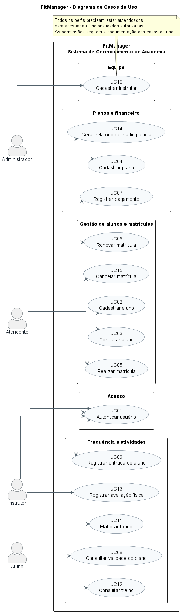

# FitManager

## Sobre o projeto

O FitManager é um sistema de gerenciamento de academia desenvolvido em Java. O objetivo é facilitar a organização das informações de alunos, instrutores, planos, pagamentos e treinos.

## Tecnologias utilizadas

- Java 21
- JavaFX
- Maven
- SQLite
- JDBC

## Como executar

É necessário ter o JDK 21 e o Maven instalados.

1. Clone ou baixe este repositório.
2. Abra o terminal na pasta do projeto.
3. Execute o comando:

```bash
mvn javafx:run
```

## Integrantes

- Leandro Feitosa de Sousa
- José Arteiro Feitosa Noronha Neto
- Bruna de Oliveira Santos
- Geovani de Araújo Alves

## Documentação

A documentação do projeto está organizada na pasta `docs/`.

### Diagrama de casos de uso

O diagrama apresenta os atores e as funcionalidades do sistema FitManager.



- [Visualizar código-fonte PlantUML](docs/diagramas/casos-de-uso-fitmanager.puml)

### Outros documentos

- [Casos de uso](docs/casos-de-uso.md)
- [Histórias de usuário](docs/historias-de-usuario.md)