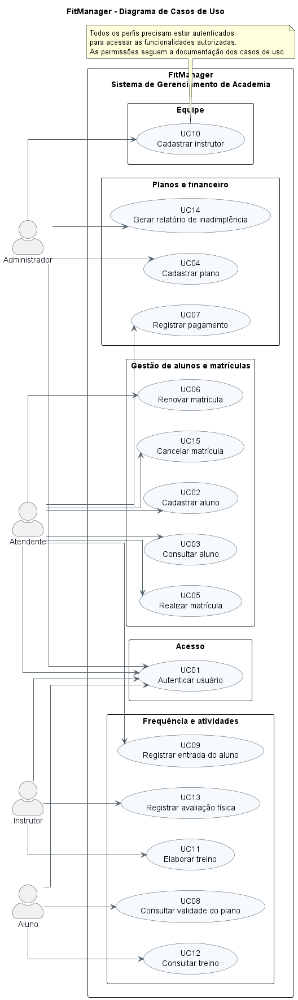
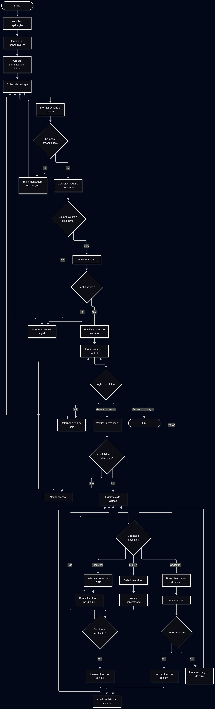
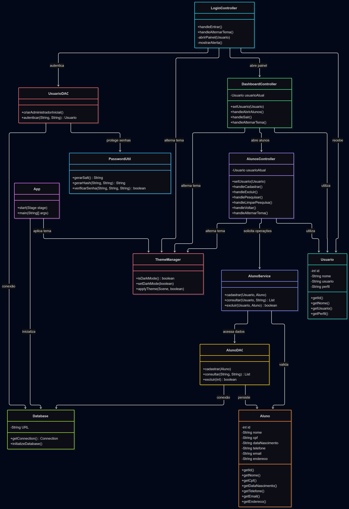
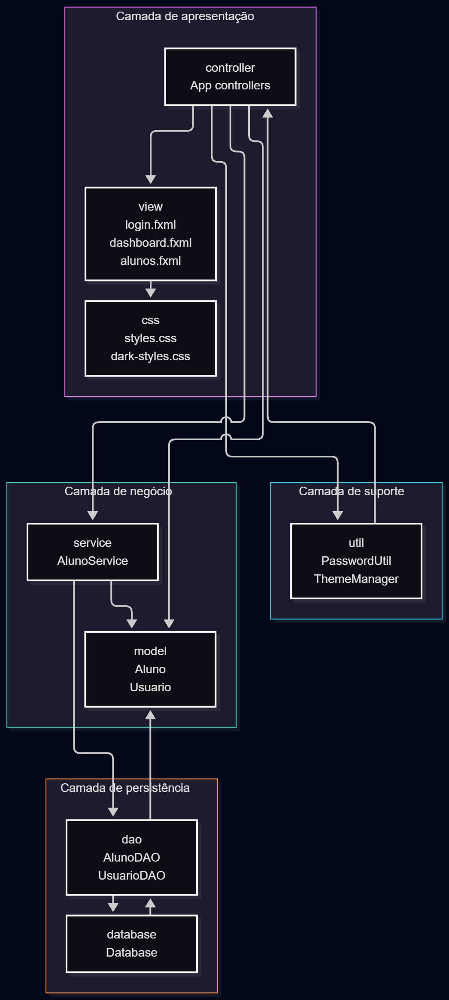

# FitManager
### Sistema de Gerenciamento de Academia

<p align="center">
  **Uma aplicação desktop para organização e gerenciamento das atividades de uma academia.**
</p>

---

## Sobre o projeto

O **FitManager** é um sistema de gerenciamento de academias desenvolvido como projeto acadêmico do curso de Análise e Desenvolvimento de Sistemas do Instituto Federal do Piauí (IFPI) – Campus Picos.

A aplicação tem como propósito centralizar informações e apoiar o gerenciamento das atividades administrativas e operacionais de uma academia, contribuindo para uma organização mais eficiente dos dados e dos processos.

O projeto está sendo desenvolvido em Java, com interface gráfica construída utilizando JavaFX e FXML, e persistência de dados por meio do banco de dados SQLite.

## Objetivos

- Desenvolver uma aplicação desktop para auxiliar no gerenciamento de academias.
- Centralizar informações relacionadas aos alunos e usuários do sistema.
- Implementar autenticação e controle de acesso por perfil.
- Organizar o código utilizando separação de responsabilidades.
- Aplicar conceitos de análise, projeto e desenvolvimento de sistemas estudados durante o curso.

## Funcionalidades

### Implementadas

- Autenticação de usuários.
- Controle de acesso conforme o perfil do usuário.
- Cadastro de alunos.
- Consulta e pesquisa de alunos.
- Exclusão de registros de alunos.
- Validação de dados cadastrais, incluindo CPF e telefone.
- Persistência de dados utilizando SQLite.
- Interface gráfica com opções de tema claro e escuro.
- Painel principal de navegação.

### Planejadas para o desenvolvimento

- Cadastro e gerenciamento de instrutores.
- Cadastro e gerenciamento de planos.
- Realização, renovação e cancelamento de matrículas.
- Registro e consulta de pagamentos.
- Acompanhamento da validade dos planos.
- Registro de frequência dos alunos.
- Elaboração e consulta de treinos.
- Registro de avaliações físicas.
- Geração de relatórios, incluindo inadimplência.

> O projeto está em desenvolvimento. A lista de funcionalidades será atualizada conforme novas etapas forem concluídas.

## Perfis de acesso

O sistema contempla diferentes perfis de usuários, com acesso condicionado às permissões correspondentes:

- **Administrador**
- **Atendente**
- **Instrutor**
- **Aluno**

A autenticação identifica o usuário e permite direcionar o acesso às funcionalidades disponíveis para seu perfil.

## Tecnologias utilizadas

| Tecnologia | Finalidade |
|---|---|
| Java 21 | Linguagem de programação |
| JavaFX | Desenvolvimento da interface gráfica |
| FXML | Estruturação das telas |
| CSS | Estilização da interface |
| Maven | Gerenciamento do projeto e dependências |
| SQLite | Banco de dados relacional |
| JDBC | Comunicação entre a aplicação e o banco de dados |
| Git | Controle de versão |
| GitHub | Hospedagem do repositório e colaboração |

## Arquitetura do projeto

O FitManager utiliza uma organização em camadas e pacotes, buscando separar as responsabilidades da aplicação:

- **Controller:** controla as interações entre a interface e as funcionalidades do sistema.
- **DAO:** realiza operações de acesso e persistência de dados.
- **Database:** concentra a inicialização e a configuração do banco de dados.
- **Model:** representa as entidades utilizadas pela aplicação.
- **Service:** concentra regras e operações relacionadas aos serviços do sistema.
- **Util:** reúne recursos auxiliares, como gerenciamento de tema e segurança de senhas.
- **Resources:** armazena arquivos FXML, folhas de estilo CSS e imagens.

A estrutura busca facilitar a manutenção, a compreensão e a evolução do código.

## Estrutura de diretórios

```text
fitmanager/
├── docs/
│   ├── diagramas/
│   ├── casos-de-uso.md
│   ├── historias-de-usuario.md
│   ├── glossario.md
│   └── README.md
├── src/
│   ├── main/
│   │   ├── java/
│   │   │   └── br/com/fitmanager/
│   │   │       ├── controller/
│   │   │       ├── dao/
│   │   │       ├── database/
│   │   │       ├── model/
│   │   │       ├── service/
│   │   │       └── util/
│   │   └── resources/
│   │       └── br/com/fitmanager/
│   │           ├── css/
│   │           ├── images/
│   │           └── view/
│   └── test/
├── pom.xml
├── .gitignore
└── README.md
```

## Pré-requisitos

Para executar o projeto, é necessário ter instalado:

- JDK 21;
- Apache Maven;
- Git (opcional, caso deseje clonar o repositório).

## Como obter o projeto

Clone o repositório:

```bash
git clone https://github.com/S0US4LF/fitmanager.git
```

Entre no diretório:

```bash
cd fitmanager
```

## Como executar

Na pasta raiz do projeto, execute:

```bash
mvn clean javafx:run
```

O Maven realizará a preparação necessária e iniciará a aplicação JavaFX.

## Banco de dados

O sistema utiliza SQLite para armazenar os dados localmente.

A inicialização do banco de dados é realizada pela própria aplicação, por meio da classe responsável pela configuração da persistência. As operações de acesso aos dados são organizadas nas classes DAO.

O arquivo do banco de dados é gerado localmente durante a execução e não deve ser enviado ao repositório.

## Documentação

A documentação técnica e acadêmica está organizada na pasta [`docs/`](docs/).

Entre os materiais disponíveis estão:

- [Casos de uso](docs/casos-de-uso.md)
- [Histórias de usuário](docs/historias-de-usuario.md)
- [Glossário](docs/glossario.md)
- [Documentação dos diagramas](docs/diagramas/)
- [Índice da documentação](docs/README.md)

### Diagramas do sistema

Os diagramas auxiliam na compreensão dos requisitos, dos fluxos de atividades e da organização estrutural do FitManager.

**Diagrama de casos de uso**



**Diagrama de atividades**



**Diagrama de classes**



**Diagrama de pacotes**



Os arquivos-fonte dos diagramas também estão disponíveis no repositório, permitindo sua consulta e edição.

## Equipe de desenvolvimento

Projeto desenvolvido por estudantes do curso de Análise e Desenvolvimento de Sistemas:

- Leandro Feitosa de Sousa
- José Arteiro Feitosa Noronha Neto
- Bruna de Oliveira Santos


## Instituição

**Instituto Federal do Piauí (IFPI)**  
Campus Picos  
Curso: Análise e Desenvolvimento de Sistemas

---

<p align="center">
  Projeto acadêmico desenvolvido para fins educacionais.
</p>